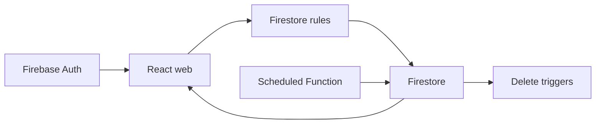

# firebase-saas-auth

Multiuser broadcast SaaS. Each account manages its own connections, contacts and messages. Sending is simulated: marking a message sent does not deliver WhatsApp, SMS or email. This guide describes the source; verify billing and deployed functions in Firebase.

## Implemented behavior

TypeScript, React 19.3, Vite 8.3, MUI 9.4, Tailwind 4.3 and Firebase Web 12.19. The web app separates app, pages, widgets, features, entities and shared; forms use React Hook Form and Zod. The browser accesses Auth and Firestore directly. Functions v2 use Node 22 and Admin SDK; rules, indexes and emulators live at the root. Vitest covers domain, components, repositories and rules.



## Workflow and failure cases

1. Registration/login → Firebase Auth → SessionProvider → route guard → uid-scoped queries. Profiles use users/{uid}; connections, contacts and messages are flat collections with clientId. Lists use onSnapshot for real-time UI updates.

2. Connection → contact with normalized phone → recipient selection → composition. Send now writes sent, a server sentAt and null scheduledAt. Scheduling writes scheduled and a future date; scheduled messages can be rescheduled or sent manually. Sent messages retain delivery fields.

3. dispatchScheduledMessages runs every minute, queries due messages by status/date and processes pages with BulkWriter. A lastUpdateTime precondition prevents overwriting concurrent edits; the next run rechecks the document. There is no external delivery integration or exact-second delivery guarantee.

4. Deleting a connection triggers cleanupDeletedConnection for related contacts/messages; deleting a contact triggers detachDeletedContact to remove it from recipients. These cleanups require deployed Functions. VITE_SCHEDULED_DISPATCH_ENABLED controls web notices and the deployment workflow condition; changing it alone does not deploy functions.

## Configuration and deployment

Use Node 22 and Java 21+ for emulators. Run install:all, copy web/.env.example, run npm run build to generate functions/lib and web/dist, then start emulators and web dev:emulators. The demo-broadcast project avoids production data. Run root lint, typecheck, test and build. For permission-denied check clientId and connection ownership; for missing indexes check firestore.indexes.json; for stalled schedules check deployment, logs and the flag. Production Cloud Functions require billing; check Firebase documentation before enabling costs. firebase-deploy is separate from GitPageDocs.

## Execution commands

```sh
npm run install:all
npm run build
npm run emulators
# In another terminal
npm --prefix web run dev:emulators
# Validation
npm run lint
npm run typecheck
npm test
npm run build
```

## Related files

- [firestore.rules](https://github.com/Vidigal-code/firebase-saas-auth/blob/8fec8eb0c5e82a43f44f1ad60372a32b5f326434/firestore.rules)
- [firebase.json](https://github.com/Vidigal-code/firebase-saas-auth/blob/8fec8eb0c5e82a43f44f1ad60372a32b5f326434/firebase.json)
- [firestore.indexes.json](https://github.com/Vidigal-code/firebase-saas-auth/blob/8fec8eb0c5e82a43f44f1ad60372a32b5f326434/firestore.indexes.json)
- [functions/src/index.ts](https://github.com/Vidigal-code/firebase-saas-auth/blob/8fec8eb0c5e82a43f44f1ad60372a32b5f326434/functions/src/index.ts)
- [functions/src/messages/dispatchDueMessages.ts](https://github.com/Vidigal-code/firebase-saas-auth/blob/8fec8eb0c5e82a43f44f1ad60372a32b5f326434/functions/src/messages/dispatchDueMessages.ts)
- [web/src/entities/message/api/messagesRepository.ts](https://github.com/Vidigal-code/firebase-saas-auth/blob/8fec8eb0c5e82a43f44f1ad60372a32b5f326434/web/src/entities/message/api/messagesRepository.ts)
- [.github/workflows/firebase-deploy.yml](https://github.com/Vidigal-code/firebase-saas-auth/blob/8fec8eb0c5e82a43f44f1ad60372a32b5f326434/.github/workflows/firebase-deploy.yml)

## Navigation

- [Project guide](?menu=en&lang=en&id=8)
- [Source reference](?menu=en&lang=en&id=9)
