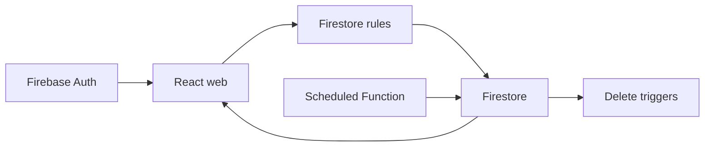

# firebase-saas-auth: Project context and workflows

GitPageDocs **0.0.26** · 1.0.0 · 2026-11-08

## Context

Multiuser broadcast SaaS. Each account manages its own connections, contacts and messages. Sending is simulated: marking a message sent does not deliver WhatsApp, SMS or email. This guide describes the source; verify billing and deployed functions in Firebase.

## Stack and architecture

TypeScript, React 19.3, Vite 8.3, MUI 9.4, Tailwind 4.3 and Firebase Web 12.19. The web app separates app, pages, widgets, features, entities and shared; forms use React Hook Form and Zod. The browser accesses Auth and Firestore directly. Functions v2 use Node 22 and Admin SDK; rules, indexes and emulators live at the root. Vitest covers domain, components, repositories and rules.



## End-to-end workflows

1. Registration/login → Firebase Auth → SessionProvider → route guard → uid-scoped queries. Profiles use users/{uid}; connections, contacts and messages are flat collections with clientId. Lists use onSnapshot for real-time UI updates.

2. Connection → contact with normalized phone → recipient selection → composition. Send now writes sent, a server sentAt and null scheduledAt. Scheduling writes scheduled and a future date; scheduled messages can be rescheduled or sent manually. Sent messages retain delivery fields.

3. dispatchScheduledMessages runs every minute, queries due messages by status/date and processes pages with BulkWriter. A lastUpdateTime precondition prevents overwriting concurrent edits; the next run rechecks the document. There is no external delivery integration or exact-second delivery guarantee.

4. Deleting a connection triggers cleanupDeletedConnection for related contacts/messages; deleting a contact triggers detachDeletedContact to remove it from recipients. These cleanups require deployed Functions. VITE_SCHEDULED_DISPATCH_ENABLED controls web notices and the deployment workflow condition; changing it alone does not deploy functions.

## Data, security and limitations

firestore.rules requires the authenticated owner, server timestamps, allowed schema and an owned connection. Names are limited to 80, content to 1000, recipients to 1–200; phones follow the rule pattern. Rules do not validate each contact ID individually: do not claim stronger referential integrity. UI guards do not replace rules. Public Firebase configuration is not an admin credential; service-account secrets stay outside the frontend.

## Setup, testing and operations

Use Node 22 and Java 21+ for emulators. Run install:all, copy web/.env.example, run npm run build to generate functions/lib and web/dist, then start emulators and web dev:emulators. The demo-broadcast project avoids production data. Run root lint, typecheck, test and build. For permission-denied check clientId and connection ownership; for missing indexes check firestore.indexes.json; for stalled schedules check deployment, logs and the flag. Production Cloud Functions require billing; check Firebase documentation before enabling costs. firebase-deploy is separate from GitPageDocs.

## Complete reference

Dependencies, commands, endpoints, variables, contracts and tests are in the [source reference](?menu=en&lang=en&id=9).

## Verifiable sources

- [firestore.rules](https://github.com/Vidigal-code/firebase-saas-auth/blob/8fec8eb0c5e82a43f44f1ad60372a32b5f326434/firestore.rules)

- [firebase.json](https://github.com/Vidigal-code/firebase-saas-auth/blob/8fec8eb0c5e82a43f44f1ad60372a32b5f326434/firebase.json)

- [firestore.indexes.json](https://github.com/Vidigal-code/firebase-saas-auth/blob/8fec8eb0c5e82a43f44f1ad60372a32b5f326434/firestore.indexes.json)

- [functions/src/index.ts](https://github.com/Vidigal-code/firebase-saas-auth/blob/8fec8eb0c5e82a43f44f1ad60372a32b5f326434/functions/src/index.ts)

- [functions/src/messages/dispatchDueMessages.ts](https://github.com/Vidigal-code/firebase-saas-auth/blob/8fec8eb0c5e82a43f44f1ad60372a32b5f326434/functions/src/messages/dispatchDueMessages.ts)

- [web/src/entities/message/api/messagesRepository.ts](https://github.com/Vidigal-code/firebase-saas-auth/blob/8fec8eb0c5e82a43f44f1ad60372a32b5f326434/web/src/entities/message/api/messagesRepository.ts)

- [.github/workflows/firebase-deploy.yml](https://github.com/Vidigal-code/firebase-saas-auth/blob/8fec8eb0c5e82a43f44f1ad60372a32b5f326434/.github/workflows/firebase-deploy.yml)

- [Firebase Functions deployment](https://firebase.google.com/docs/functions/get-started)

## Documentation navigation with GitPageDocs 0.0.26

The options in this section require the GitPageDocs **0.0.26** runtime. This project's documentation version remains **1.0.0**. Updating text and configuration does not itself update the runtime deployed by the workflow.

### Tag-based contents

In `gitpagedocs/docs/versions/1.0.0/config.json`, each `routes-md` item uses `RouteguideBrand: true` and `RouteGuideTags: ["h1", "h2", "h3"]`. The contents list includes the first three heading levels; other headings remain in the document. Property names are case-sensitive.

```json
{ "RouteguideBrand": true, "RouteGuideTags": ["h1", "h2", "h3"] }
```

Omitting `RouteGuideTags` preserves the legacy behavior, from `h1` through `h6`. An empty list (`[]`) removes automatic tag entries; explicit markers configured in `markdownMarkers.items` can still populate the contents list.

To include other elements, add tag names allowed by the sanitizer, such as `"p"`, `"blockquote"`, `"pre"`, `"table"`, `"img"`, `"details"` or `"summary"`. There is no wildcard: `"*"`, dangerous tags and invalid entries are ignored with a diagnostic. Including `p`, `li`, `div` or `span` may produce many entries; select only tags useful for reading.

Labels use a title, alternative text or element text. Empty elements such as `br`, `hr`, `img` and `input` can use the tag name. Automatic IDs are stable, unique and scoped to each block. Use `markdownMarkers.items` to select an occurrence, supply a custom label or apply a specific highlight.

### Scrolling, small screens and foldables

With contents scrolling unlocked, the active entry is centered, including navigation through Previous/Next. The lock preserves the position selected manually in the contents list. This lets readers inspect another part of the list without automatic tracking repositioning it.

When validating on a phone, check the collapsed menu, touch targets, keyboard focus, tables and horizontally scrollable code blocks. On foldable devices, repeat navigation folded and unfolded, in both orientations, and confirm the active entry remains accessible after the width changes. Use the pause control when animated effects are present and respect reduced-motion preferences.

GitPageDocs 0.0.26 uses `performance.mode: "auto"` for theme effects: it moderately reduces density on desktop and uses a smaller budget below 768px while retaining the theme's layers. Hidden particles pause and resume the same phase when the width changes. To keep full density, merge `site.backgroundEffects.overrides.performance: { "mode": "full" }` into `gitpagedocs/config.json`; the same option is available in `site.backgroundEffects.themes[themeId].performance`. An explicit `layers` override keeps the complete count when no mode is set in the overrides. Select `"auto"` explicitly to apply the budget to custom layers too.

## Fixed theme family and light/dark mode

`HideThemeSelector: true` hides the full theme picker and keeps the family selected by `ThemeDefault`. It still allows light/dark switching when that family has a valid pair. A different theme from the URL or browser storage cannot replace the fixed family.

`ThemeModeDefault` is the initial fallback. A valid mode from `modetheme=light` or `modetheme=dark` in the URL, a saved mode, or the reader’s toggle can select light/dark within that family. The selected mode survives reloads and document navigation. On narrow screens, open Menu to reach the standard control. Without a valid pair, the control is omitted.

Both entries in the layout catalog must enable `supportsLightAndDarkModes`, share the same nonempty `supportsLightAndDarkModesReference`, and declare opposite `mode` values (`light` and `dark`). This project uses the official paired catalog; keep its family and preferences when updating runtime or layout pins.

## Desktop side-guide height

On desktop screens wider than 1024 CSS pixels, the side guide ends after its last entry instead of stretching to the article height. Since 0.0.25, it can grow to the available viewport height below the header before its entries need internal scrolling. This side layout takes precedence over `TocScrollMaxHeightDesktop`; centered guides above the content and layouts at 1024 pixels and below retain their previous sizing rules. A small bar in the active entry's theme color follows the section marked while scrolling. The indicator uses the existing section tracking without continuous animation. In GitPageDocs 0.0.26, side guides have an extra 0.5rem of space below the header (8px at the default root font size) and retain 1rem below the card at the viewport limit. This adjustment applies only above 1024 CSS pixels; smaller layouts are unchanged.
