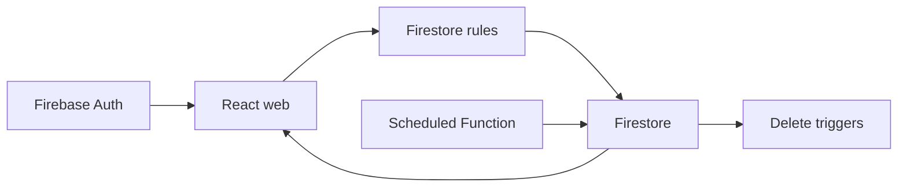

# firebase-saas-auth

SaaS de difusión multiusuario. Cada cuenta gestiona sus conexiones, contactos y mensajes. El envío es simulado: marcar sent no entrega WhatsApp, SMS ni correo. Esta guía describe el código; compruebe la facturación y las funciones desplegadas en Firebase.

## Comportamiento implementado

TypeScript, React 19.3, Vite 8.3, MUI 9.4, Tailwind 4.3 y Firebase Web 12.19. El web separa app, pages, widgets, features, entities y shared; usa React Hook Form y Zod. El navegador accede directamente a Auth y Firestore. Functions v2 usan Node 22 y Admin SDK; reglas, índices y emuladores están en la raíz. Vitest cubre dominio, componentes, repositorios y reglas.



## Flujo y casos de fallo

1. Registro/login → Firebase Auth → SessionProvider → guard de ruta → consultas por uid. Los perfiles usan users/{uid}; conexiones, contactos y mensajes son colecciones planas con clientId. Las listas usan onSnapshot en tiempo real.

2. Conexión → contacto con teléfono normalizado → destinatarios → composición. Enviar ahora guarda sent, sentAt del servidor y scheduledAt nulo. Programar guarda scheduled y fecha futura; se puede reprogramar o enviar manualmente. Los mensajes enviados conservan sus campos de entrega.

3. dispatchScheduledMessages se ejecuta cada minuto, consulta mensajes vencidos y procesa páginas con BulkWriter. lastUpdateTime evita sobrescribir cambios concurrentes; la siguiente ejecución reevalúa el documento. No hay entrega externa ni garantía de ejecución en el segundo exacto.

4. Eliminar una conexión activa cleanupDeletedConnection; eliminar un contacto activa detachDeletedContact para retirarlo de los destinatarios. Estas limpiezas requieren Functions desplegadas. VITE_SCHEDULED_DISPATCH_ENABLED controla avisos y la condición del workflow; cambiarla por sí sola no publica funciones.

## Configuración y despliegue

Use Node 22 y Java 21+ para emuladores. Ejecute install:all, copie web/.env.example, ejecute npm run build para generar functions/lib y web/dist, y después inicie emulators y web dev:emulators. demo-broadcast evita datos reales. Ejecute lint, typecheck, test y build en la raíz. Ante permission-denied revise clientId y conexión; ante índices ausentes revise firestore.indexes.json; ante agendas detenidas revise despliegue, logs y flag. Functions en producción requieren facturación; consulte Firebase antes de habilitar costes. firebase-deploy es independiente de GitPageDocs.

## Comandos de ejecución

```sh
npm run install:all
npm run build
npm run emulators
# In another terminal
npm --prefix web run dev:emulators
# Validation
npm run lint
npm run typecheck
npm test
npm run build
```

## Archivos relacionados

- [firestore.rules](https://github.com/Vidigal-code/firebase-saas-auth/blob/8fec8eb0c5e82a43f44f1ad60372a32b5f326434/firestore.rules)
- [firebase.json](https://github.com/Vidigal-code/firebase-saas-auth/blob/8fec8eb0c5e82a43f44f1ad60372a32b5f326434/firebase.json)
- [firestore.indexes.json](https://github.com/Vidigal-code/firebase-saas-auth/blob/8fec8eb0c5e82a43f44f1ad60372a32b5f326434/firestore.indexes.json)
- [functions/src/index.ts](https://github.com/Vidigal-code/firebase-saas-auth/blob/8fec8eb0c5e82a43f44f1ad60372a32b5f326434/functions/src/index.ts)
- [functions/src/messages/dispatchDueMessages.ts](https://github.com/Vidigal-code/firebase-saas-auth/blob/8fec8eb0c5e82a43f44f1ad60372a32b5f326434/functions/src/messages/dispatchDueMessages.ts)
- [web/src/entities/message/api/messagesRepository.ts](https://github.com/Vidigal-code/firebase-saas-auth/blob/8fec8eb0c5e82a43f44f1ad60372a32b5f326434/web/src/entities/message/api/messagesRepository.ts)
- [.github/workflows/firebase-deploy.yml](https://github.com/Vidigal-code/firebase-saas-auth/blob/8fec8eb0c5e82a43f44f1ad60372a32b5f326434/.github/workflows/firebase-deploy.yml)

## Navegación

- [Project guide](?menu=es&lang=es&id=8)
- [Source reference](?menu=es&lang=es&id=9)
