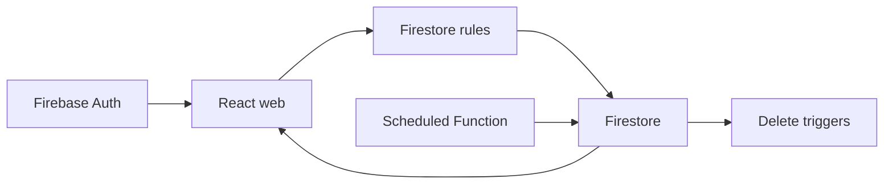

# firebase-saas-auth: Contexto y flujos del proyecto

GitPageDocs **0.0.26** · 1.0.0 · 2026-11-08

## Contexto

SaaS de difusión multiusuario. Cada cuenta gestiona sus conexiones, contactos y mensajes. El envío es simulado: marcar sent no entrega WhatsApp, SMS ni correo. Esta guía describe el código; compruebe la facturación y las funciones desplegadas en Firebase.

## Stack y arquitectura

TypeScript, React 19.3, Vite 8.3, MUI 9.4, Tailwind 4.3 y Firebase Web 12.19. El web separa app, pages, widgets, features, entities y shared; usa React Hook Form y Zod. El navegador accede directamente a Auth y Firestore. Functions v2 usan Node 22 y Admin SDK; reglas, índices y emuladores están en la raíz. Vitest cubre dominio, componentes, repositorios y reglas.



## Flujos completos

1. Registro/login → Firebase Auth → SessionProvider → guard de ruta → consultas por uid. Los perfiles usan users/{uid}; conexiones, contactos y mensajes son colecciones planas con clientId. Las listas usan onSnapshot en tiempo real.

2. Conexión → contacto con teléfono normalizado → destinatarios → composición. Enviar ahora guarda sent, sentAt del servidor y scheduledAt nulo. Programar guarda scheduled y fecha futura; se puede reprogramar o enviar manualmente. Los mensajes enviados conservan sus campos de entrega.

3. dispatchScheduledMessages se ejecuta cada minuto, consulta mensajes vencidos y procesa páginas con BulkWriter. lastUpdateTime evita sobrescribir cambios concurrentes; la siguiente ejecución reevalúa el documento. No hay entrega externa ni garantía de ejecución en el segundo exacto.

4. Eliminar una conexión activa cleanupDeletedConnection; eliminar un contacto activa detachDeletedContact para retirarlo de los destinatarios. Estas limpiezas requieren Functions desplegadas. VITE_SCHEDULED_DISPATCH_ENABLED controla avisos y la condición del workflow; cambiarla por sí sola no publica funciones.

## Datos, seguridad y límites

firestore.rules exige propietario autenticado, timestamps del servidor, esquema permitido y conexión propia. Nombres: 80; contenido: 1000; destinatarios: 1–200; teléfono según el patrón de reglas. Las reglas no validan cada ID de contacto individualmente; no garantizan integridad referencial adicional. Los guards de interfaz no sustituyen las reglas. Las credenciales administrativas no pertenecen al frontend.

## Ejecución, pruebas y operación

Use Node 22 y Java 21+ para emuladores. Ejecute install:all, copie web/.env.example, ejecute npm run build para generar functions/lib y web/dist, y después inicie emulators y web dev:emulators. demo-broadcast evita datos reales. Ejecute lint, typecheck, test y build en la raíz. Ante permission-denied revise clientId y conexión; ante índices ausentes revise firestore.indexes.json; ante agendas detenidas revise despliegue, logs y flag. Functions en producción requieren facturación; consulte Firebase antes de habilitar costes. firebase-deploy es independiente de GitPageDocs.

## Referencia completa

Dependencias, comandos, endpoints, variables, contratos y pruebas están en la [referencia del código](?menu=es&lang=es&id=9).

## Fuentes verificables

- [firestore.rules](https://github.com/Vidigal-code/firebase-saas-auth/blob/8fec8eb0c5e82a43f44f1ad60372a32b5f326434/firestore.rules)

- [firebase.json](https://github.com/Vidigal-code/firebase-saas-auth/blob/8fec8eb0c5e82a43f44f1ad60372a32b5f326434/firebase.json)

- [firestore.indexes.json](https://github.com/Vidigal-code/firebase-saas-auth/blob/8fec8eb0c5e82a43f44f1ad60372a32b5f326434/firestore.indexes.json)

- [functions/src/index.ts](https://github.com/Vidigal-code/firebase-saas-auth/blob/8fec8eb0c5e82a43f44f1ad60372a32b5f326434/functions/src/index.ts)

- [functions/src/messages/dispatchDueMessages.ts](https://github.com/Vidigal-code/firebase-saas-auth/blob/8fec8eb0c5e82a43f44f1ad60372a32b5f326434/functions/src/messages/dispatchDueMessages.ts)

- [web/src/entities/message/api/messagesRepository.ts](https://github.com/Vidigal-code/firebase-saas-auth/blob/8fec8eb0c5e82a43f44f1ad60372a32b5f326434/web/src/entities/message/api/messagesRepository.ts)

- [.github/workflows/firebase-deploy.yml](https://github.com/Vidigal-code/firebase-saas-auth/blob/8fec8eb0c5e82a43f44f1ad60372a32b5f326434/.github/workflows/firebase-deploy.yml)

- [Firebase Functions deployment](https://firebase.google.com/docs/functions/get-started)

## Navegación de la documentación con GitPageDocs 0.0.26

Las opciones de esta sección requieren el runtime GitPageDocs **0.0.26**. La versión documental de este proyecto sigue siendo **1.0.0**. Actualizar texto y configuración no actualiza por sí solo el runtime publicado por el workflow.

### Índice por etiquetas

En `gitpagedocs/docs/versions/1.0.0/config.json`, cada elemento de `routes-md` utiliza `RouteguideBrand: true` y `RouteGuideTags: ["h1", "h2", "h3"]`. El índice incluye los tres primeros niveles de encabezados; los demás permanecen en el documento. Los nombres de propiedades distinguen mayúsculas y minúsculas.

```json
{ "RouteguideBrand": true, "RouteGuideTags": ["h1", "h2", "h3"] }
```

Omitir `RouteGuideTags` conserva el comportamiento anterior, de `h1` a `h6`. Una lista vacía (`[]`) elimina las entradas automáticas por etiqueta; los marcadores explícitos configurados en `markdownMarkers.items` todavía pueden formar parte del índice.

Para incluir otros elementos, añada nombres de etiquetas permitidas por el sanitizador, como `"p"`, `"blockquote"`, `"pre"`, `"table"`, `"img"`, `"details"` o `"summary"`. No hay comodines: `"*"`, las etiquetas peligrosas y las entradas inválidas se ignoran con un diagnóstico. Incluir `p`, `li`, `div` o `span` puede generar muchas entradas; seleccione solo las etiquetas útiles para la lectura.

Los rótulos usan título, texto alternativo o texto del elemento. Los elementos vacíos como `br`, `hr`, `img` e `input` pueden usar el nombre de la etiqueta. Los IDs automáticos son estables, únicos y separados por bloque. Utilice `markdownMarkers.items` para elegir una ocurrencia, definir un rótulo propio o aplicar un resaltado específico.

### Desplazamiento, pantallas pequeñas y plegables

Con el desplazamiento del índice desbloqueado, la entrada activa queda centrada, incluso al navegar con Anterior/Siguiente. El candado conserva la posición elegida manualmente en el índice. Esto permite consultar otra parte del índice sin que el seguimiento automático desplace la lista.

Al validar en un móvil, revise el menú contraído, las áreas táctiles, el foco del teclado, las tablas y los bloques de código con desplazamiento horizontal. En dispositivos plegables, repita la navegación con la pantalla plegada y abierta, en ambas orientaciones, y compruebe que la entrada activa siga accesible tras cambiar el ancho. Utilice el control de pausa cuando haya efectos animados y respete la preferencia de movimiento reducido.

GitPageDocs 0.0.26 utiliza `performance.mode: "auto"` para los efectos de los temas: reduce moderadamente la densidad en escritorio y utiliza un presupuesto menor por debajo de 768px, conservando las capas del tema. Las partículas ocultas se pausan y retoman la misma fase al cambiar el ancho. Para mantener la densidad completa, combine `site.backgroundEffects.overrides.performance: { "mode": "full" }` con `gitpagedocs/config.json`; la misma opción está disponible en `site.backgroundEffects.themes[themeId].performance`. Un override explícito de `layers` conserva la cantidad completa cuando no se define mode en los overrides. Seleccione `"auto"` explícitamente para aplicar el presupuesto también a las capas personalizadas.

## Familia de tema fija y modo claro/oscuro

`HideThemeSelector: true` oculta el selector completo de temas y mantiene la familia elegida por `ThemeDefault`. La alternancia claro/oscuro sigue disponible cuando esa familia tiene un par válido. Un tema diferente procedente de la URL o del almacenamiento del navegador no sustituye la familia fija.

`ThemeModeDefault` es el valor inicial de respaldo. Un modo válido en `modetheme=light` o `modetheme=dark` de la URL, un modo guardado o el botón del lector puede seleccionar claro/oscuro dentro de esa familia. El modo elegido se conserva al recargar y navegar entre documentos. En pantallas estrechas, abra Menu para acceder al control estándar. Sin un par válido, el control no aparece.

Las dos entradas del catálogo de layouts deben habilitar `supportsLightAndDarkModes`, compartir el mismo `supportsLightAndDarkModesReference` no vacío y declarar valores opuestos de `mode` (`light` y `dark`). Este proyecto utiliza el catálogo oficial con pares; conserve su familia y preferencias al actualizar los pins del runtime o de los layouts.

## Altura de la guía lateral de escritorio

En pantallas de escritorio con más de 1024 píxeles CSS, la guía lateral termina después de su última entrada, sin extenderse hasta el final del artículo. Desde 0.0.25, puede crecer hasta la altura disponible de la ventana debajo de la cabecera antes de necesitar desplazamiento interno. Este diseño lateral tiene prioridad sobre `TocScrollMaxHeightDesktop`; la guía centrada encima del contenido y los diseños de hasta 1024 píxeles mantienen sus reglas de tamaño anteriores. Una pequeña barra con el color de la entrada activa sigue la sección marcada al desplazarse. El indicador utiliza el seguimiento de secciones existente, sin animación continua. En GitPageDocs 0.0.26, las guías laterales ganan 0.5rem adicionales de espacio debajo de la cabecera (8px con la fuente raíz predeterminada) y conservan 1rem debajo de la tarjeta en el límite de la ventana. Este ajuste se aplica solo por encima de 1024 píxeles CSS; los diseños menores se mantienen.
