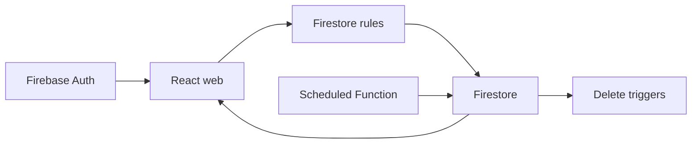

# firebase-saas-auth: Contexto e fluxos do projeto

GitPageDocs **0.0.26** · 1.0.0 · 2026-11-08

## Contexto

SaaS de broadcast multiusuário. Cada conta gerencia conexões, contatos e mensagens próprias. O envio é uma simulação: marcar uma mensagem como sent não entrega WhatsApp, SMS ou e-mail. A documentação descreve o código local; o estado de faturamento e as funções efetivamente publicadas devem ser conferidos no Firebase.

## Stack e arquitetura

TypeScript, React 19.3, Vite 8.3, MUI 9.4, Tailwind 4.3 e Firebase Web 12.19. O web separa app, pages, widgets, features, entities e shared; formulários usam React Hook Form e Zod. O navegador acessa Auth e Firestore diretamente. Functions v2 usam Node 22 e Admin SDK; regras, índices e emuladores ficam na raiz. Vitest testa domínio, componentes, repositórios e regras.



## Fluxos completos

1. Cadastro/login → Firebase Auth → SessionProvider → guard de rota → consultas filtradas pelo uid. A criação do perfil usa users/{uid}; conexões, contatos e mensagens são coleções planas com clientId. Listas usam onSnapshot e atualizam a interface em tempo real.

2. Conexão → contato com telefone normalizado → seleção dos destinatários → composição. Enviar agora grava status sent, sentAt do servidor e scheduledAt nulo. Agendar grava scheduled e data futura; é possível reagendar ou enviar uma mensagem agendada manualmente. Uma mensagem já enviada mantém seus campos de entrega.

3. dispatchScheduledMessages executa a cada minuto, consulta mensagens vencidas por status/data e processa páginas com BulkWriter. A precondição lastUpdateTime evita sobrescrever uma edição concorrente; a próxima execução reavalia o documento. Não há integração externa de entrega nem garantia de disparo no segundo exato.

4. Excluir conexão dispara cleanupDeletedConnection para remover contatos e mensagens relacionados; excluir contato dispara detachDeletedContact para removê-lo dos destinatários. Essas limpezas dependem das Functions implantadas. VITE_SCHEDULED_DISPATCH_ENABLED controla os avisos do web e a condição do workflow de deploy; mudar a flag sozinha não publica funções.

## Dados, segurança e limites

firestore.rules exige proprietário autenticado, timestamps do servidor, esquema permitido e vínculo da conexão ao mesmo cliente. Nomes têm limite 80; conteúdo 1000; destinatários entre 1 e 200; telefone segue o padrão definido nas regras. A lista de IDs de contatos não é validada individualmente pelas regras: não atribua a elas uma garantia adicional de integridade referencial. Guards de interface não substituem as regras. A configuração pública Firebase não é credencial administrativa; secrets de conta de serviço ficam fora do frontend.

## Execução, testes e operação

Use Node 22 e Java 21+ para os emuladores. Execute install:all, copie web/.env.example, execute npm run build para gerar functions/lib e web/dist, e então inicie emulators e web dev:emulators. O projeto demo-broadcast evita atingir dados reais. Rode lint, typecheck, test e build na raiz. Para permission-denied confira clientId e a conexão; para consultas com índice ausente confira firestore.indexes.json; para agendamentos parados confira implantação, logs e flag. Cloud Functions em produção dependem de faturamento habilitado; consulte a documentação Firebase antes de ativar custos. O workflow firebase-deploy é separado do GitPageDocs.

## Referência completa

Dependências, comandos, endpoints, variáveis, contratos e testes estão na [referência do código](?menu=pt&lang=pt&id=9).

## Fontes verificáveis

- [firestore.rules](https://github.com/Vidigal-code/firebase-saas-auth/blob/8fec8eb0c5e82a43f44f1ad60372a32b5f326434/firestore.rules)

- [firebase.json](https://github.com/Vidigal-code/firebase-saas-auth/blob/8fec8eb0c5e82a43f44f1ad60372a32b5f326434/firebase.json)

- [firestore.indexes.json](https://github.com/Vidigal-code/firebase-saas-auth/blob/8fec8eb0c5e82a43f44f1ad60372a32b5f326434/firestore.indexes.json)

- [functions/src/index.ts](https://github.com/Vidigal-code/firebase-saas-auth/blob/8fec8eb0c5e82a43f44f1ad60372a32b5f326434/functions/src/index.ts)

- [functions/src/messages/dispatchDueMessages.ts](https://github.com/Vidigal-code/firebase-saas-auth/blob/8fec8eb0c5e82a43f44f1ad60372a32b5f326434/functions/src/messages/dispatchDueMessages.ts)

- [web/src/entities/message/api/messagesRepository.ts](https://github.com/Vidigal-code/firebase-saas-auth/blob/8fec8eb0c5e82a43f44f1ad60372a32b5f326434/web/src/entities/message/api/messagesRepository.ts)

- [.github/workflows/firebase-deploy.yml](https://github.com/Vidigal-code/firebase-saas-auth/blob/8fec8eb0c5e82a43f44f1ad60372a32b5f326434/.github/workflows/firebase-deploy.yml)

- [Firebase Functions deployment](https://firebase.google.com/docs/functions/get-started)

## Navegação da documentação com GitPageDocs 0.0.26

As opções desta seção requerem o runtime GitPageDocs **0.0.26**. A versão documental deste projeto continua **1.0.0**. Atualizar o texto e a configuração não atualiza, por si só, o runtime publicado pelo workflow.

### Índice por tags

Em `gitpagedocs/docs/versions/1.0.0/config.json`, cada item de `routes-md` usa `RouteguideBrand: true` e `RouteGuideTags: ["h1", "h2", "h3"]`. O índice mantém os três primeiros níveis de títulos; os demais títulos continuam no documento. A grafia das propriedades diferencia maiúsculas e minúsculas.

```json
{ "RouteguideBrand": true, "RouteGuideTags": ["h1", "h2", "h3"] }
```

Omitir `RouteGuideTags` preserva o comportamento legado, com `h1` até `h6`. Uma lista vazia (`[]`) remove as entradas automáticas por tag; marcadores explícitos configurados em `markdownMarkers.items` ainda podem compor o índice.

Para incluir outros elementos, acrescente nomes de tags permitidas pelo sanitizador, por exemplo `"p"`, `"blockquote"`, `"pre"`, `"table"`, `"img"`, `"details"` ou `"summary"`. Não existe curinga: `"*"`, tags perigosas e entradas inválidas são ignorados com diagnóstico. Incluir `p`, `li`, `div` ou `span` pode gerar muitas entradas; prefira somente as tags úteis para a leitura.

Os rótulos usam título, texto alternativo ou texto do elemento. Elementos vazios como `br`, `hr`, `img` e `input` podem usar o nome da tag. IDs automáticos são estáveis, únicos e separados por bloco. Use `markdownMarkers.items` quando precisar escolher uma ocorrência, definir rótulo próprio ou aplicar um destaque específico.

### Rolagem, telas pequenas e dobráveis

Com a rolagem do índice desbloqueada, o item ativo é centralizado, inclusive ao navegar por Anterior/Próximo. O cadeado preserva a posição escolhida manualmente no índice. Isso permite consultar outra parte do índice sem que o acompanhamento automático reposicione a lista.

Ao validar em celular, confira o menu recolhido, alvos de toque, foco por teclado, tabelas e blocos de código com rolagem horizontal. Em dispositivos dobráveis, repita a navegação com a tela dobrada e aberta, nas duas orientações, e confirme que o item ativo permanece acessível após a mudança de largura. Use o controle de pausa quando houver efeitos animados e respeite a preferência de movimento reduzido.

O GitPageDocs 0.0.26 usa `performance.mode: "auto"` nos efeitos dos temas: reduz moderadamente a densidade no desktop e usa um orçamento menor abaixo de 768px, mantendo as camadas do tema. Partículas ocultas ficam pausadas e retomam a mesma fase ao mudar a largura. Para manter a densidade completa, mescle `site.backgroundEffects.overrides.performance: { "mode": "full" }` em `gitpagedocs/config.json`; a mesma opção pode ser definida em `site.backgroundEffects.themes[themeId].performance`. Um override explícito de `layers` mantém a contagem completa quando não há mode definido nos overrides. Use `"auto"` explicitamente para aplicar o orçamento também às camadas personalizadas.

## Família de tema fixa e modo claro/escuro

`HideThemeSelector: true` oculta o seletor completo de temas e mantém a família escolhida por `ThemeDefault`. A alternância claro/escuro continua disponível quando essa família possui um par válido. Um tema diferente vindo da URL ou do armazenamento do navegador não substitui a família fixa.

`ThemeModeDefault` é o fallback inicial. Um modo válido em `modetheme=light` ou `modetheme=dark` na URL, um modo salvo ou o botão do leitor pode selecionar claro/escuro dentro dessa família. O modo escolhido permanece após recarregar e navegar entre documentos. Em telas estreitas, abra Menu para acessar o controle padrão. Sem um par válido, o controle não aparece.

As duas entradas do catálogo de layouts devem habilitar `supportsLightAndDarkModes`, compartilhar o mesmo `supportsLightAndDarkModesReference` não vazio e declarar valores opostos de `mode` (`light` e `dark`). Este projeto usa o catálogo oficial com pares; preserve sua família e preferências ao atualizar os pins do runtime ou dos layouts.

## Altura do guia lateral desktop

Em telas desktop com mais de 1024 pixels CSS, o guia lateral termina após o último item, sem se estender até o fim do artigo. Desde a 0.0.25, ele pode crescer até a altura disponível da janela abaixo do cabeçalho antes de precisar de rolagem interna. Esse layout lateral tem prioridade sobre `TocScrollMaxHeightDesktop`; o guia centralizado acima do conteúdo e os layouts de até 1024 pixels mantêm suas regras anteriores de dimensionamento. Uma pequena barra na cor do item ativo acompanha a seção marcada durante a rolagem. O indicador usa o acompanhamento de seções existente, sem animação contínua. No GitPageDocs 0.0.26, os guias laterais ganham mais 0.5rem de espaço abaixo do cabeçalho (8px com a fonte raiz padrão) e mantêm 1rem abaixo do cartão no limite da viewport. Esse ajuste vale somente acima de 1024 pixels CSS; os layouts menores são preservados.
