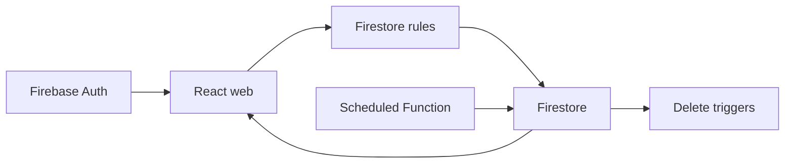

# Visão geral do projeto

SaaS de broadcast multiusuário. Cada conta gerencia conexões, contatos e mensagens próprias. O envio é uma simulação: marcar uma mensagem como sent não entrega WhatsApp, SMS ou e-mail. A documentação descreve o código local; o estado de faturamento e as funções efetivamente publicadas devem ser conferidos no Firebase.

## Comportamento implementado

TypeScript, React 19.3, Vite 8.3, MUI 9.4, Tailwind 4.3 e Firebase Web 12.19. O web separa app, pages, widgets, features, entities e shared; formulários usam React Hook Form e Zod. O navegador acessa Auth e Firestore diretamente. Functions v2 usam Node 22 e Admin SDK; regras, índices e emuladores ficam na raiz. Vitest testa domínio, componentes, repositórios e regras.



## Fluxo e casos de falha

1. Cadastro/login → Firebase Auth → SessionProvider → guard de rota → consultas filtradas pelo uid. A criação do perfil usa users/{uid}; conexões, contatos e mensagens são coleções planas com clientId. Listas usam onSnapshot e atualizam a interface em tempo real.

2. Conexão → contato com telefone normalizado → seleção dos destinatários → composição. Enviar agora grava status sent, sentAt do servidor e scheduledAt nulo. Agendar grava scheduled e data futura; é possível reagendar ou enviar uma mensagem agendada manualmente. Uma mensagem já enviada mantém seus campos de entrega.

3. dispatchScheduledMessages executa a cada minuto, consulta mensagens vencidas por status/data e processa páginas com BulkWriter. A precondição lastUpdateTime evita sobrescrever uma edição concorrente; a próxima execução reavalia o documento. Não há integração externa de entrega nem garantia de disparo no segundo exato.

4. Excluir conexão dispara cleanupDeletedConnection para remover contatos e mensagens relacionados; excluir contato dispara detachDeletedContact para removê-lo dos destinatários. Essas limpezas dependem das Functions implantadas. VITE_SCHEDULED_DISPATCH_ENABLED controla os avisos do web e a condição do workflow de deploy; mudar a flag sozinha não publica funções.

## Configuração e implantação

Use Node 22 e Java 21+ para os emuladores. Execute install:all, copie web/.env.example, execute npm run build para gerar functions/lib e web/dist, e então inicie emulators e web dev:emulators. O projeto demo-broadcast evita atingir dados reais. Rode lint, typecheck, test e build na raiz. Para permission-denied confira clientId e a conexão; para consultas com índice ausente confira firestore.indexes.json; para agendamentos parados confira implantação, logs e flag. Cloud Functions em produção dependem de faturamento habilitado; consulte a documentação Firebase antes de ativar custos. O workflow firebase-deploy é separado do GitPageDocs.

## Comandos de execução

```sh
npm run install:all
npm run build
npm run emulators
# In another terminal
npm --prefix web run dev:emulators
# Validation
npm run lint
npm run typecheck
npm test
npm run build
```

## Arquivos relacionados

- [firestore.rules](https://github.com/Vidigal-code/firebase-saas-auth/blob/8fec8eb0c5e82a43f44f1ad60372a32b5f326434/firestore.rules)
- [firebase.json](https://github.com/Vidigal-code/firebase-saas-auth/blob/8fec8eb0c5e82a43f44f1ad60372a32b5f326434/firebase.json)
- [firestore.indexes.json](https://github.com/Vidigal-code/firebase-saas-auth/blob/8fec8eb0c5e82a43f44f1ad60372a32b5f326434/firestore.indexes.json)
- [functions/src/index.ts](https://github.com/Vidigal-code/firebase-saas-auth/blob/8fec8eb0c5e82a43f44f1ad60372a32b5f326434/functions/src/index.ts)
- [functions/src/messages/dispatchDueMessages.ts](https://github.com/Vidigal-code/firebase-saas-auth/blob/8fec8eb0c5e82a43f44f1ad60372a32b5f326434/functions/src/messages/dispatchDueMessages.ts)
- [web/src/entities/message/api/messagesRepository.ts](https://github.com/Vidigal-code/firebase-saas-auth/blob/8fec8eb0c5e82a43f44f1ad60372a32b5f326434/web/src/entities/message/api/messagesRepository.ts)
- [.github/workflows/firebase-deploy.yml](https://github.com/Vidigal-code/firebase-saas-auth/blob/8fec8eb0c5e82a43f44f1ad60372a32b5f326434/.github/workflows/firebase-deploy.yml)

## Navegação

- [Project guide](?menu=pt&lang=pt&id=8)
- [Source reference](?menu=pt&lang=pt&id=9)
